<p align="center"></p>

<h1 align="center">biubiu AI</h1>

<p align="center">贴在 ZCode 旁边的模型与账户助手：登录 biubiu AI 账户，一键把分组和站内 Key 的模型加进 ZCode；也能接入任何 OpenAI / Anthropic 兼容的服务。</p>

<p align="center">
  <a href="https://github.com/drhhhao/Zcode-biubiuAI/releases/latest"><b>⬇ 下载最新版安装程序</b></a>
  &nbsp;·&nbsp;
  <a href="https://gitee.com/drhhhao_0/Zcode-biubiuAI/releases"><b>⬇ 国内下载（Gitee）</b></a>
  &nbsp;·&nbsp;
  <a href="#从下载到用上一步一步来"><b>🚀 从下载到用上</b></a>
  &nbsp;·&nbsp;
  <a href="docs/tutorial.md"><b>📖 图文使用教程</b></a>
  &nbsp;·&nbsp;
  <a href="docs/development.md">开发说明</a>
</p>

<p align="center">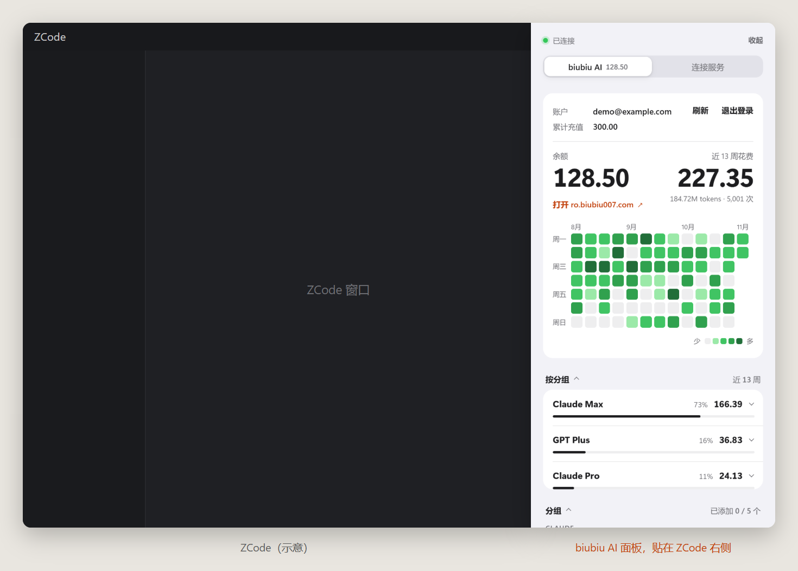</p>

## 它能做什么

- **biubiu AI 账户**：用 ro.biubiu007.com 的邮箱和密码登录，余额、累计充值、分组和站内 Key 一目了然；面板显示时每 30 秒自动刷新余额。
- **用量一目了然**：余额旁边是近 13 周的花费，下面是 GitHub 那样的每日用量图（绿色越深花得越多）；按分组看各花了多少钱，点开分组能看到每个模型的花费。
- **添加分组**：点分组的「添加」，在分组下面列出它能用的模型，勾选的才加进 ZCode。分组还没有 Key 时，面板会先问你要不要在网站上新建一个。
- **站内 Key 选择模型**：在 Key 下方展开它能用的模型，勾选的就是在 ZCode 里用的，取消勾选就移除，还能先「测试」一下；每个 Key 都标着计费倍率。
- **分组选择模型**：已加入的分组可以对照网站现在提供的模型来勾选，网站新加的模型不会一下子全塞进 ZCode，下架的模型也会标出来。
- **连接其他服务**：填写服务地址和 API Key，获取模型列表，勾选后加进 ZCode。
- **管理已导入的服务**：点「N 个模型」自动读取服务现在的模型，勾选增减（新模型等你勾选，停供的标出来）；查看（Key 默认隐藏）、修改地址和 Key、删除。
- **省心**：模型的上下文、最大输出和推理档位自动填好；每次修改 ZCode 配置前自动备份。
- **跟着 ZCode 走**：贴在 ZCode 窗口旁边，跟随移动和缩放；ZCode 最大化时收成右边缘的小标签，点开就能用，最小化时自动隐藏；明暗主题跟随 ZCode。
- **一键更新**：有新版本时提醒一次，更不更新由你决定；点一下就自动下载、核对并安装，设置和登录都保留。

## 从下载到用上：一步一步来

一共 8 步，前 3 步是下载和安装，只做一次。截图里的**红框和数字**就是要点的地方，按数字顺序点。

- [第 1 步：下载并安装 ZCode](#第-1-步下载并安装-zcode)
- [第 2 步：下载 biubiu AI](#第-2-步下载-biubiu-ai)
- [第 3 步：安装 biubiu AI](#第-3-步安装-biubiu-ai)
- [第 4 步：打开 ZCode，找到 biubiu AI 面板](#第-4-步打开-zcode找到-biubiu-ai-面板)
- [第 5 步：登录 biubiu AI 账户](#第-5-步登录-biubiu-ai-账户)
- [第 6 步：添加分组，勾选要用的模型](#第-6-步添加分组勾选要用的模型)
- [第 7 步：回到 ZCode 选用模型](#第-7-步回到-zcode-选用模型)
- [第 8 步（可选）：接入其他服务、以后增减模型](#第-8-步可选接入其他服务以后增减模型)

### 第 1 步：下载并安装 ZCode

biubiu AI 是贴在 ZCode 旁边用的，所以先装 ZCode。已经装好 ZCode 的，直接看第 2 步。

1. 打开 ZCode 官网：**<https://zcode.z.ai/cn>**
2. 点页面中间的 **「立即下载 ZCode」①**（按钮下方写着「适用于 Windows」）。浏览器会开始下载 `ZCode-版本号-win-x64.exe`。

<p align="center"></p>

3. 如果按钮下方写的不是 Windows，点按钮下面的 **「查看全部下载」**，在「Windows」一栏点 **「Windows（64 位）」①**。用 ARM 处理器的 Windows 电脑（少见）选「Windows (ARM64)」。

<p align="center">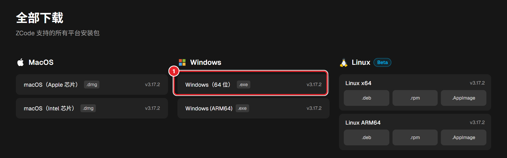</p>

4. 下载完成后，双击下载的 `ZCode-…-win-x64.exe`，按 ZCode 安装程序的提示装好。
5. 打开一次 ZCode，确认它能正常使用。

### 第 2 步：下载 biubiu AI

下面两个地方的文件完全一样，**任选一个**。国内网络打开 GitHub 慢的话，用 Gitee。

**方式一：GitHub**

1. 打开 **<https://github.com/drhhhao/Zcode-biubiuAI/releases/latest>**
2. 页面往下翻，找到 **Assets**，点 **`biubiuAI-Setup-版本号.exe`①**（文件名里的版本号以页面上为准）。**不要**点下面的「Source code」，那是源代码，不是安装程序。

<p align="center">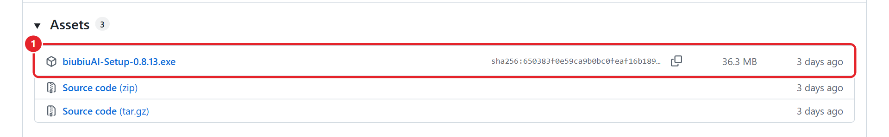</p>

**方式二：Gitee（国内更快）**

1. 打开 **<https://gitee.com/drhhhao_0/Zcode-biubiuAI/releases>**
2. 最上面一个版本就是最新版。在它的「下载」里点 **`biubiuAI-Setup-版本号.exe`①**，同样不要点「Source code」。

<p align="center"></p>

> **浏览器提示“不常下载”？** Edge 可能在下载列表里说这个文件“不常下载”。把鼠标移到这条下载上，点右边的 **「…」→「保留」**；如果又弹出提示，点 **「显示更多」→「仍然保留」**。安装程序的 SHA-256 写在 GitHub 发行说明里，可以对照核验。

### 第 3 步：安装 biubiu AI

1. 打开下载的文件夹（一般是「下载」），**双击** `biubiuAI-Setup-版本号.exe`。
2. **如果弹出蓝色的「Windows 已保护你的电脑」**：先点窗口里的 **「更多信息」**，再点出现的 **「仍要运行」**。这是因为安装程序暂时没有数字签名，第一次运行时 Windows 都会这样提示。
3. 安装窗口打开后，直接点右下角的 **「安装」①**。
   - 「安装位置」一般不用改，想换位置就点「更改…」。
   - 「在桌面创建快捷方式」「登录 Windows 后在后台待命，打开 ZCode 时自动出现」建议保持勾选：以后开机后打开 ZCode，biubiu AI 会自己出现。
   - 不需要管理员权限，也不用另装 Node.js 等任何东西，需要的运行环境会一起装好。

<p align="center">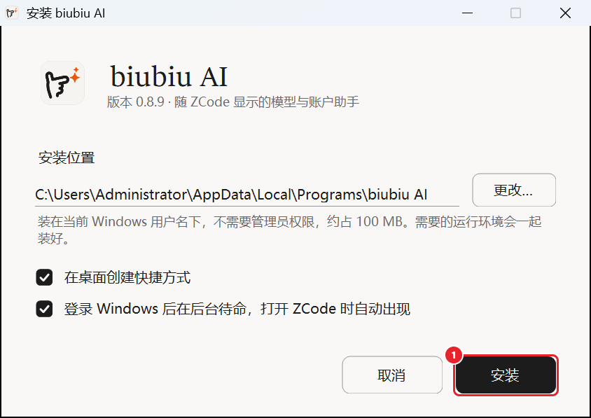</p>

4. 等进度条走完（通常几秒钟）。极少数没有 WebView2 运行时的 Windows 10 电脑，这一步需要联网，安装程序会自动下载。

<p align="center">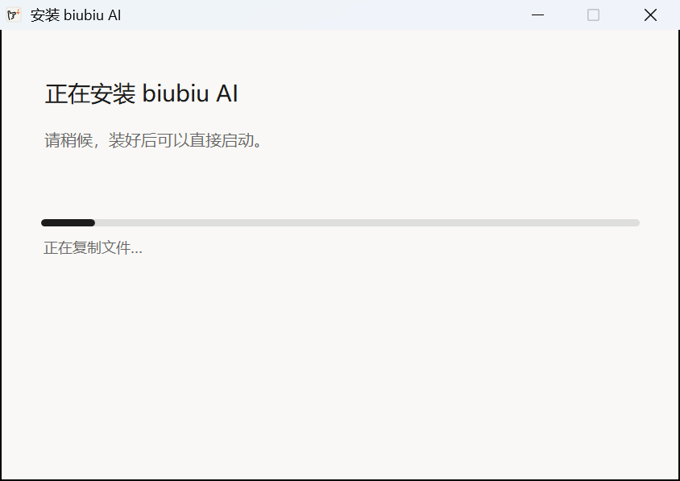</p>

5. 看到「安装完成」后，保持勾选 **「现在启动 biubiu AI」①**，点 **「完成」②**。

<p align="center">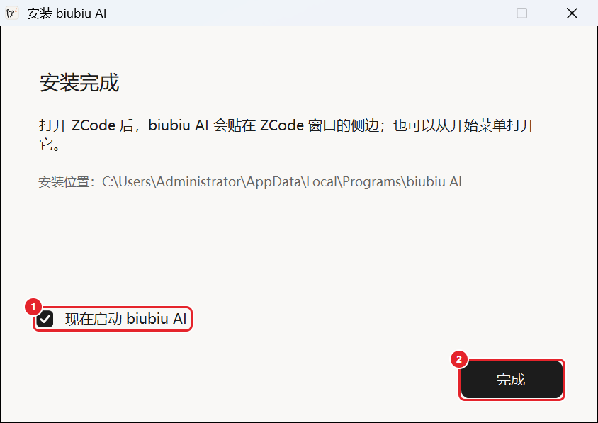</p>

### 第 4 步：打开 ZCode，找到 biubiu AI 面板

1. 打开 ZCode。biubiu AI 的面板会**自动贴在 ZCode 窗口右侧**（右边放不下时贴在左侧），跟着 ZCode 一起移动、缩放。

<p align="center"></p>

2. **看不到面板？**
   - **ZCode 是最大化的**：旁边没有空位，面板会收成 ZCode 右边缘内侧的一个小标签（下图），**点它**就能展开面板，再点面板顶部的「收起」收回去。
   - ZCode 最小化时面板会自动隐藏，把 ZCode 恢复出来就好。
   - 也可以按快捷键 **`Ctrl + Alt + M`**，或者**单击屏幕右下角托盘里的 biubiu AI 图标**（小手枪图标，可能藏在「^」里）展开面板；面板出不来时会弹通知说明原因。

<p align="center"></p>

3. 第一次打开面板时会弹出 **「使用教程」**。点 **「开始」①**，它会高亮下一步要点的地方，带你走完第 5～7 步；不想看点「跳过」，按下面的步骤自己做也一样。以后想再看，点面板底部版本号旁边的「使用教程」。

<p align="center">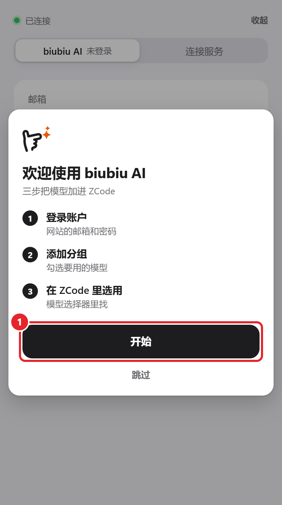</p>

### 第 5 步：登录 biubiu AI 账户

面板默认打开 **biubiu AI** 标签页。还没有账户的话，先到 <https://ro.biubiu007.com> 注册。

1. 在 **「邮箱」①** 里填注册时用的邮箱。
2. 在 **「密码」②** 里填网站的登录密码。
3. 点 **「登录」③**。

<p align="center">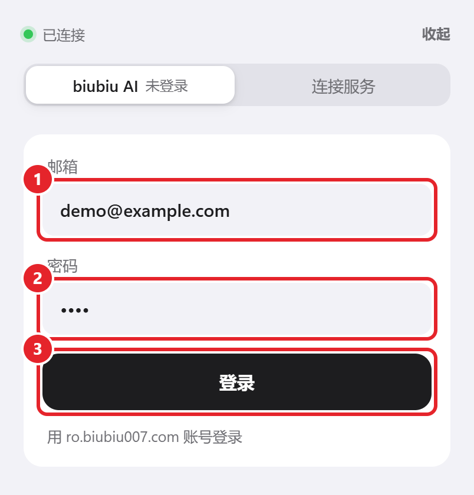</p>

登录后能看到余额、累计充值、近 13 周的用量、分组和站内 Key。密码只用来登录，不会保存；登录状态加密保存在本机，下次打开不用再登录。

### 第 6 步：添加分组，勾选要用的模型

1. 往下找到 **「分组」**。每个分组右边橙色的 **×0.6、×1** 是计费倍率，**越小越省**。选一个分组，点它右边的 **「添加」①**。

<p align="center">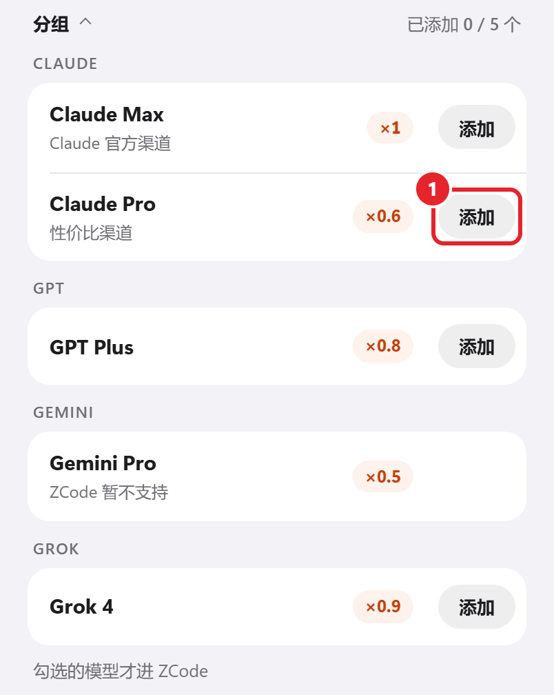</p>

2. **如果这个分组还没有 Key**，这一行下面会问你要不要新建一个，点 **「新建 Key 并选择模型」①**（会在网站上新建一个不限额度、不过期的 Key，名字是「ZCode · 分组名」）。已经有 Key 的分组不会问，直接到下一步。

<p align="center">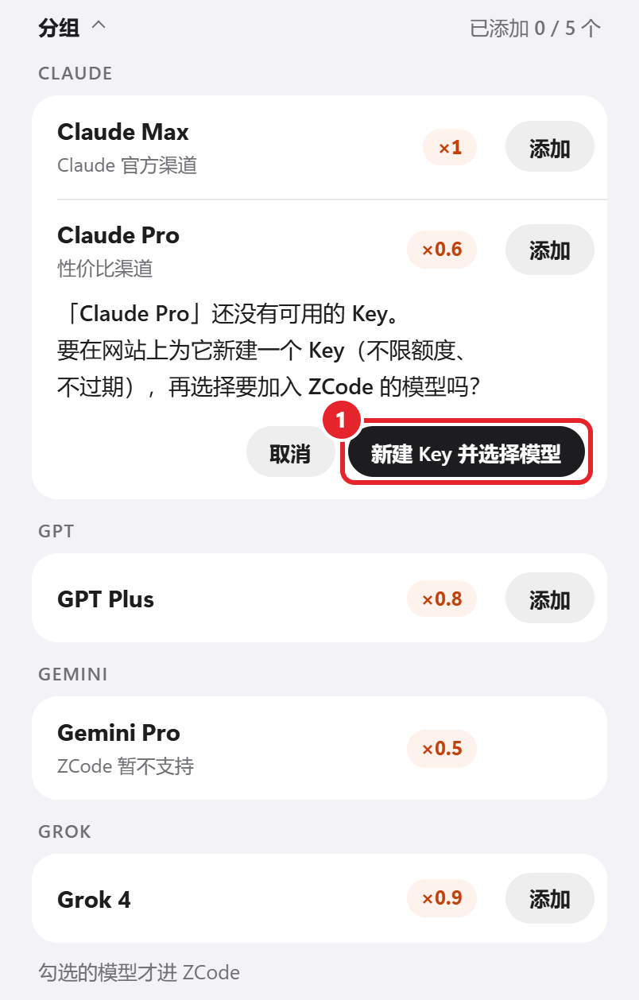</p>

3. 分组下面会列出它能用的模型。**勾选**你要用的模型①（模型多时上面有搜索框；每个模型旁边的「测试」可以先试一下能不能用，会消耗一点点额度），然后点 **「添加到 ZCode（N 个）」②**。

<p align="center">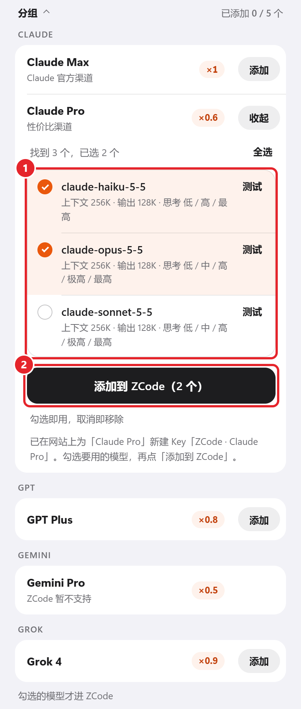</p>

4. 看到下面这行字①，就说明已经加好了。修改 ZCode 配置之前，biubiu AI 都会自动备份原来的配置。

<p align="center">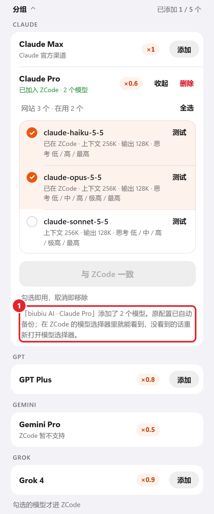</p>

想用别的分组，重复这一步就行。以后要增减这个分组的模型，点它的 **「选择模型」**，勾上的加入、取消勾选的移除，再点「保存」。

### 第 7 步：回到 ZCode 选用模型

1. 回到 ZCode，打开它的**模型选择器**（选择对话用哪个模型的地方）。
2. 找到名为 **「biubiu AI · 分组名」** 的服务（例如「biubiu AI · Claude Pro」），里面就是刚才勾选的模型，点一下就能用。
3. 没看到的话，把模型选择器关掉再打开一次。

### 第 8 步（可选）：接入其他服务、以后增减模型

**接入其他服务商**（任何 OpenAI 兼容或 Anthropic 接口的服务）：

1. 点面板顶部的 **「连接服务」** 标签①。
2. 在 **「服务地址」②** 里填服务商给的 API 地址，例如 `https://api.example.com/v1`。
3. 在 **「API Key」③** 里粘贴服务商给你的 Key。
4. 点 **「获取模型」④**。（接口类型和在 ZCode 里显示的名字在「更多设置」里，一般不用改。）

<p align="center">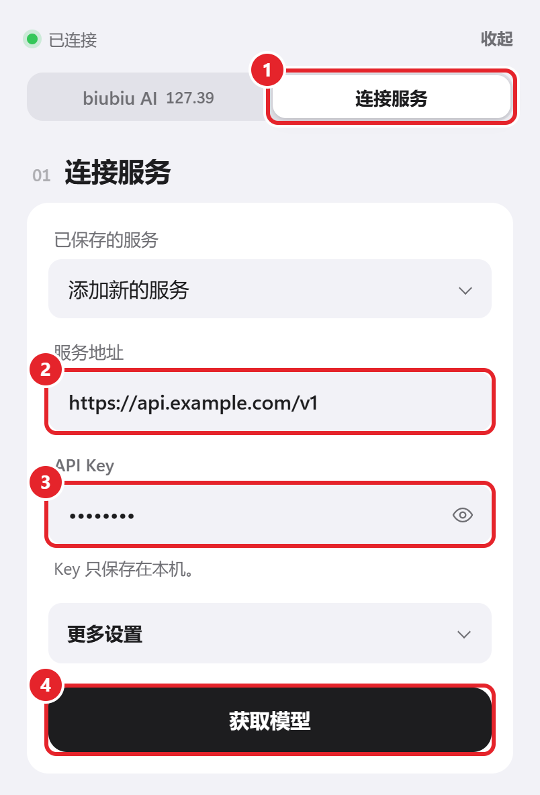</p>

5. 下面会列出这个服务的全部模型。**勾选**要用的①，点 **「添加到 ZCode（N 个）」②**。之后在 ZCode 的模型选择器里找你填的服务名（不填就是网址的域名）。

<p align="center">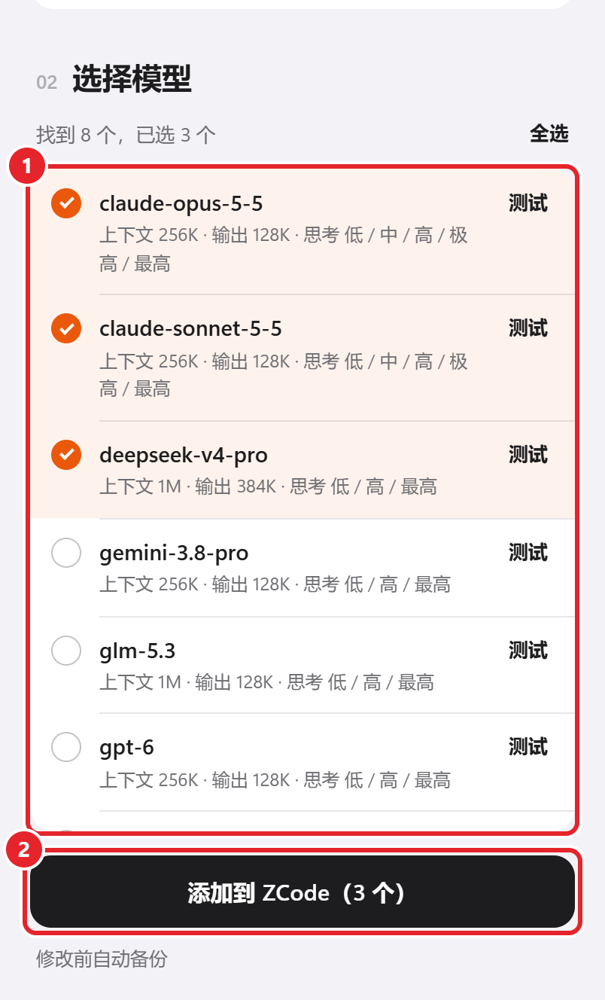</p>

**以后增减模型**（服务商上新了模型，或者有模型不用了）：

1. 在「连接服务」页最下面的 **「已导入的服务」** 里，点服务右上角的 **「N 个模型」①**。

<p align="center">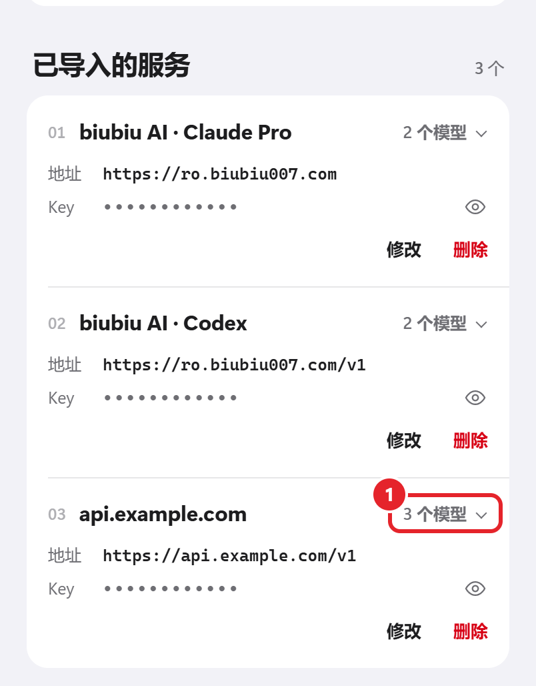</p>

2. biubiu AI 会自动读取这个服务现在提供的模型，列在服务下面：已经在 ZCode 里的默认勾选，新出的模型没勾，服务已经不提供的排在最后。**勾上**要加的、**取消勾选**要去掉的①，点 **「保存（添加 N 个、移除 N 个）」②**。

<p align="center">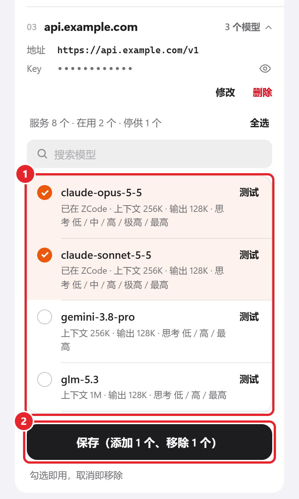</p>

在这里还能点小眼睛查看 Key，点「修改」改地址和 Key，点「删除」再点「确认删除」删掉整个服务。

更多用法（站内 Key、退出登录、打开网站、更新、卸载等）见 **[图文使用教程](docs/tutorial.md)**。

## 系统要求

- 64 位的 Windows 10 或 Windows 11，已安装 ZCode。
- 安装时不需要管理员权限（默认装在当前用户名下）。
- 极少数没有 WebView2 运行时的 Windows 10 电脑，安装时需要联网，安装程序会自动下载安装。

## 隐私与安全

- biubiu AI 只在你的电脑上运行。API Key 只写进你电脑上的 ZCode 配置，面板里默认用圆点隐藏，点小眼睛才显示。
- 网站密码只用来登录，不保存；登录状态加密保存在本机，换一个 Windows 用户也打不开。
- 不修改 ZCode 的程序文件，不注入 ZCode 进程；修改模型配置前自动备份原配置（保留最近 10 份）。
- 卸载时只删除它自己装的文件；你可以选择是否同时删除设置和登录状态。
- 检查更新只读取本仓库在 GitHub 上的 Releases，不上传任何数据；安装程序先从国内的 Gitee 镜像下载，不成功再从 GitHub 下载，都要和 GitHub 记录的文件哈希（SHA-256）一致才会安装。

## 常见问题

- **装好后看不到面板？** 先打开 ZCode。ZCode 最大化时，面板收成 ZCode 右边缘内侧的小标签，点它展开；最小化时面板会隐藏。也可以按 `Ctrl+Alt+M`，或单击任务栏右下角的 biubiu AI 图标，面板出不来时会提示原因。
- **加进去的模型在哪里？** 在 ZCode 的模型选择里，服务名是「biubiu AI · 分组名」或你填写的服务名。
- **怎么更新？** 有新版本时 biubiu AI 会弹出一次通知；点通知、托盘菜单的「更新到 x.y.z」或面板底部的「更新」，确认后自动下载、核对并安装，设置和登录状态都会保留（0.8.9 起；0.8.8 请手动下载新版本安装一次）。也可以随时下载新版本的安装程序再装一次。
- **怎么卸载？** Windows「设置 → 应用」里找到 biubiu AI，点「卸载」。

更多问题见教程里的 [常见问题](docs/tutorial.md#13-常见问题)。

## 开发者

源码结构、构建、测试和打包安装程序的方法见 [开发说明](docs/development.md)。常用命令：

```powershell
npm test                 # 单元测试
npm run app:build        # 编译桌面外挂
npm run app:installer    # 打包安装程序到 dist\
```
