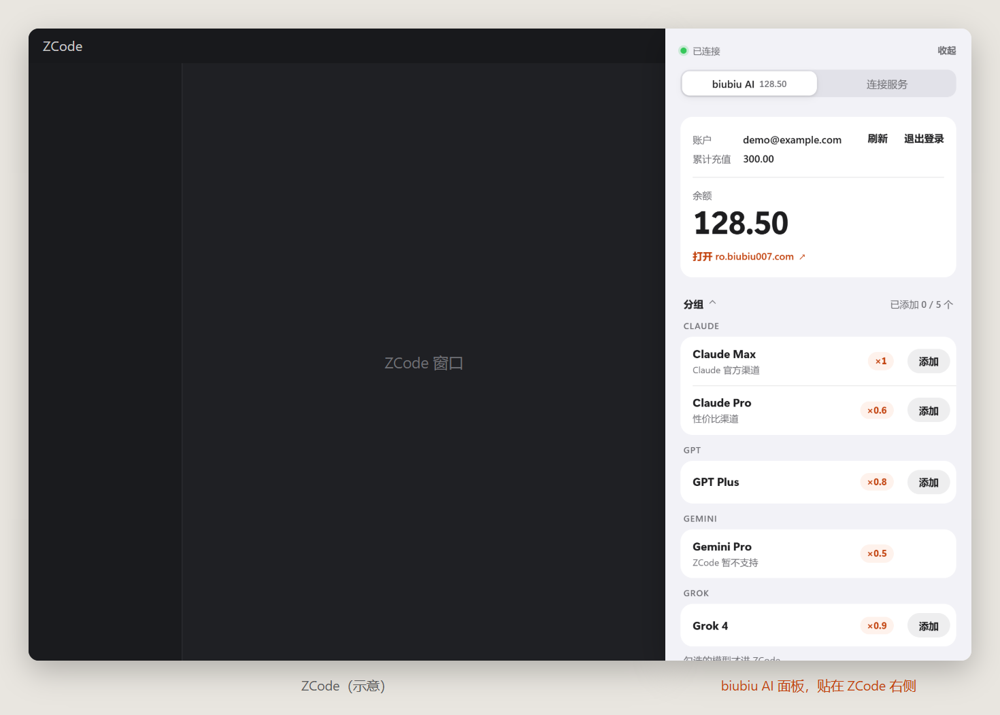

<p align="center"></p>

<h1 align="center">biubiu AI</h1>

<p align="center">贴在 ZCode 旁边的模型与账户助手：登录 biubiu AI 账户，一键把分组和站内 Key 的模型加进 ZCode；也能接入任何 OpenAI / Anthropic 兼容的服务。</p>

<p align="center">
  <a href="https://github.com/drhhhao/Zcode-biubiuAI/releases/latest"><b>⬇ 下载最新版安装程序</b></a>
  &nbsp;·&nbsp;
  <a href="https://gitee.com/drhhhao_0/Zcode-biubiuAI/releases"><b>⬇ 国内下载（Gitee）</b></a>
  &nbsp;·&nbsp;
  <a href="docs/tutorial.md"><b>📖 图文使用教程</b></a>
  &nbsp;·&nbsp;
  <a href="docs/development.md">开发说明</a>
</p>

<p align="center"></p>

## 它能做什么

- **biubiu AI 账户**：用 ro.biubiu007.com 的邮箱和密码登录，余额、累计充值、分组和站内 Key 一目了然；面板显示时每 30 秒自动刷新余额。
- **添加分组**：点分组的「添加」，在分组下面列出它能用的模型，勾选的才加进 ZCode。分组还没有 Key 时，面板会先问你要不要在网站上新建一个。
- **站内 Key 选择模型**：在 Key 下方展开它能用的模型，勾选的就是在 ZCode 里用的，取消勾选就移除，还能先「测试」一下；每个 Key 都标着计费倍率。
- **分组选择模型**：已加入的分组可以对照网站现在提供的模型来勾选，网站新加的模型不会一下子全塞进 ZCode，下架的模型也会标出来。
- **连接其他服务**：填写服务地址和 API Key，获取模型列表，勾选后加进 ZCode。
- **管理已导入的服务**：查看（Key 默认隐藏）、修改地址和 Key、删除。
- **省心**：模型的上下文、最大输出和推理档位自动填好；每次修改 ZCode 配置前自动备份。
- **跟着 ZCode 走**：贴在 ZCode 窗口旁边，跟随移动和缩放；ZCode 最大化时收成右边缘的小标签，点开就能用，最小化时自动隐藏；明暗主题跟随 ZCode。
- **一键更新**：有新版本时提醒一次，更不更新由你决定；点一下就自动下载、核对并安装，设置和登录都保留。

## 三步上手

1. **下载**：打开 [Releases 页面](https://github.com/drhhhao/Zcode-biubiuAI/releases/latest)，在 Assets 里下载 `biubiuAI-Setup-<版本号>.exe`。GitHub 慢的话，从国内的 [Gitee 镜像](https://gitee.com/drhhhao_0/Zcode-biubiuAI/releases) 下载同一个文件。
2. **安装**：双击下载的文件，点「安装」。第一次运行时 Windows 可能提示“Windows 已保护你的电脑”，点「更多信息」→「仍要运行」。不用另装 Node.js 等任何东西，需要的运行环境安装程序会一起装好。
3. **使用**：打开 ZCode，biubiu AI 面板会贴在 ZCode 窗口旁边，第一次打开时「使用教程」会带你一步步做：登录 biubiu AI 账户，点分组的「添加」并勾选模型，回到 ZCode 的模型选择里就能选到这些模型。

每一步的截图和更多用法见 **[图文使用教程](docs/tutorial.md)**。

## 系统要求

- 64 位的 Windows 10 或 Windows 11，已安装 ZCode。
- 安装时不需要管理员权限（默认装在当前用户名下）。
- 极少数没有 WebView2 运行时的 Windows 10 电脑，安装时需要联网，安装程序会自动下载安装。

## 隐私与安全

- biubiu AI 只在你的电脑上运行。API Key 只写进你电脑上的 ZCode 配置，面板里默认用圆点隐藏，点小眼睛才显示。
- 网站密码只用来登录，不保存；登录状态加密保存在本机，换一个 Windows 用户也打不开。
- 不修改 ZCode 的程序文件，不注入 ZCode 进程；修改模型配置前自动备份原配置（保留最近 10 份）。
- 卸载时只删除它自己装的文件；你可以选择是否同时删除设置和登录状态。
- 检查更新只读取本仓库在 GitHub 上的 Releases，不上传任何数据；安装程序先从国内的 Gitee 镜像下载，不成功再从 GitHub 下载，都要和 GitHub 记录的文件哈希（SHA-256）一致才会安装。

## 常见问题

- **装好后看不到面板？** 先打开 ZCode。ZCode 最大化时，面板收成 ZCode 右边缘内侧的小标签，点它展开；最小化时面板会隐藏。也可以按 `Ctrl+Alt+M`，或单击任务栏右下角的 biubiu AI 图标，面板出不来时会提示原因。
- **加进去的模型在哪里？** 在 ZCode 的模型选择里，服务名是「biubiu AI · 分组名」或你填写的服务名。
- **怎么更新？** 有新版本时 biubiu AI 会弹出一次通知；点通知、托盘菜单的「更新到 x.y.z」或面板底部的「更新」，确认后自动下载、核对并安装，设置和登录状态都会保留（0.8.9 起；0.8.8 请手动下载新版本安装一次）。也可以随时下载新版本的安装程序再装一次。
- **怎么卸载？** Windows「设置 → 应用」里找到 biubiu AI，点「卸载」。

更多问题见教程里的 [常见问题](docs/tutorial.md#13-常见问题)。

## 开发者

源码结构、构建、测试和打包安装程序的方法见 [开发说明](docs/development.md)。常用命令：

```powershell
npm test                 # 单元测试
npm run app:build        # 编译桌面外挂
npm run app:installer    # 打包安装程序到 dist\
```
