# biubiu AI 图文使用教程

biubiu AI 是一个贴在 ZCode 窗口旁边的小面板：登录 biubiu AI 账户后，点一下就能把分组或站内 Key 的模型加进 ZCode；也能接入其他 OpenAI / Anthropic 兼容的服务，并管理 ZCode 里已经加好的服务。本教程按第一次使用的顺序编写，截图来自 0.8.11 版，安装和卸载页面的截图来自 0.8.9 版，界面相同（截图里的账户、Key 和服务都是演示数据）。

## 目录

1. [下载安装程序](#1-下载安装程序)
2. [安装](#2-安装)
3. [第一次打开](#3-第一次打开)
4. [登录 biubiu AI 账户](#4-登录-biubiu-ai-账户)
5. [一键添加分组](#5-一键添加分组)
6. [用站内 Key 选择模型](#6-用站内-key-选择模型)
7. [连接其他服务](#7-连接其他服务)
8. [管理已导入的服务](#8-管理已导入的服务)
9. [打开网站](#9-打开网站)
10. [收起、贴边和快捷键](#10-收起贴边和快捷键)
11. [托盘菜单和开机启动](#11-托盘菜单和开机启动)
12. [更新和卸载](#12-更新和卸载)
13. [常见问题](#13-常见问题)

## 1. 下载安装程序

1. 打开 biubiu AI 的发布页面：<https://github.com/drhhhao/Zcode-biubiuAI/releases/latest>
2. 在页面下方的 **Assets** 里点 **`biubiuAI-Setup-<版本号>.exe`**（约 36 MB，下图橙色框），浏览器会把它下载到“下载”文件夹。

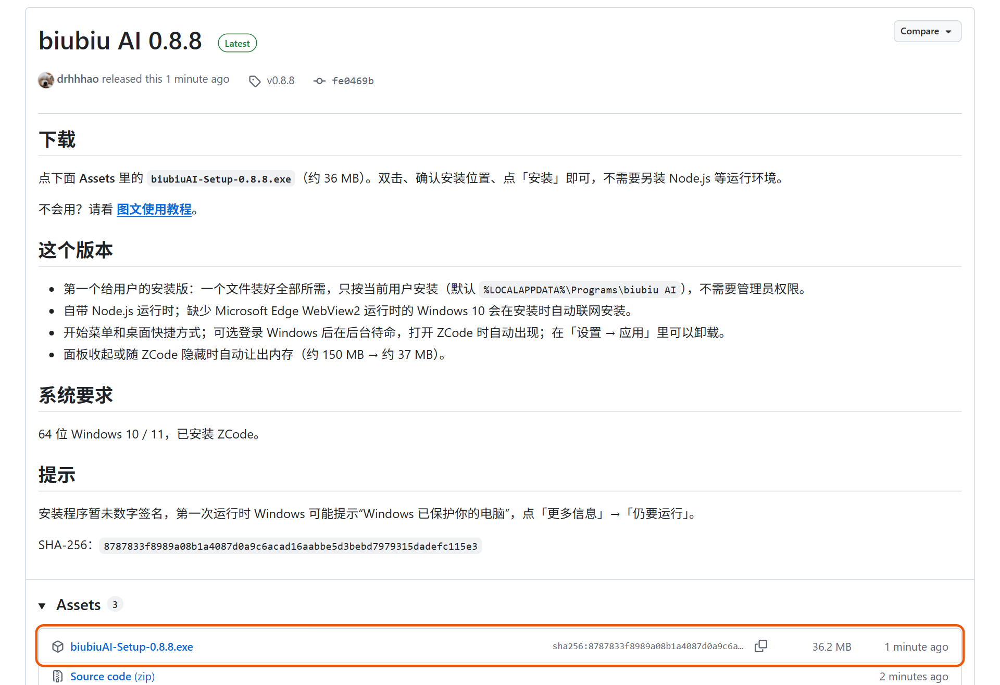

整个 biubiu AI 只有这一个文件。Node.js、WebView2 等运行环境都由它负责，不需要另外下载或安装。

> GitHub 在国内有时打开或下载较慢，失败了换个时间再试，或者用其他网络。
>
> 想确认文件完整，可以在 PowerShell 里运行 `Get-FileHash .\biubiuAI-Setup-<版本号>.exe`，把结果和发布页面上写的 SHA-256 对比。

## 2. 安装

**第一步：运行安装程序。** 双击下载好的 `biubiuAI-Setup-<版本号>.exe`。

第一次运行时，Windows 可能弹出蓝色的“**Windows 已保护你的电脑**”提示。这是因为安装程序还没有数字签名，并不是发现了问题。点提示里的 **更多信息**，再点出现的 **仍要运行** 即可。如果杀毒软件拦截，选择“允许”或“信任”。

**第二步：确认安装位置。** 安装程序只有这一页：

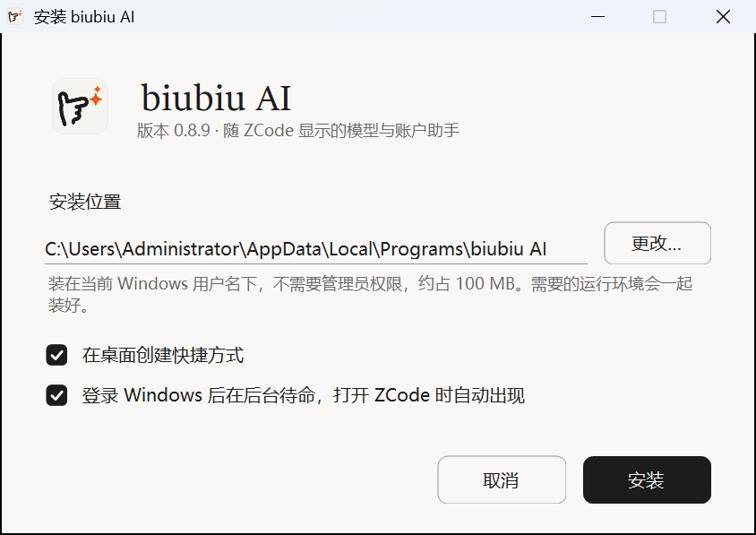

- **安装位置**：默认是 `C:\Users\<你的用户名>\AppData\Local\Programs\biubiu AI`，装在当前 Windows 用户名下，不需要管理员权限，大约占 100 MB。想换位置，点 **更改…** 选一个文件夹；如果选的文件夹里已经有别的文件，安装程序会自动在里面新建一个「biubiu AI」文件夹，不会和你的文件混在一起。
- **在桌面创建快捷方式**：默认勾选。
- **登录 Windows 后在后台待命，打开 ZCode 时自动出现**：默认勾选，推荐保留。勾选后开机时 biubiu AI 在后台静静等待，一打开 ZCode 就贴在旁边出现（和你上次用完时一样，展开成面板或收成小标签）；不勾选的话，每次要手动打开 biubiu AI。以后也可以在托盘菜单里改（见第 11 节）。

点 **安装**。

**第三步：等待安装完成。** 一般几秒钟就好。少数没有 WebView2 运行时的 Windows 10 电脑，这一步会自动从微软下载安装（需要联网，可能要几分钟）。

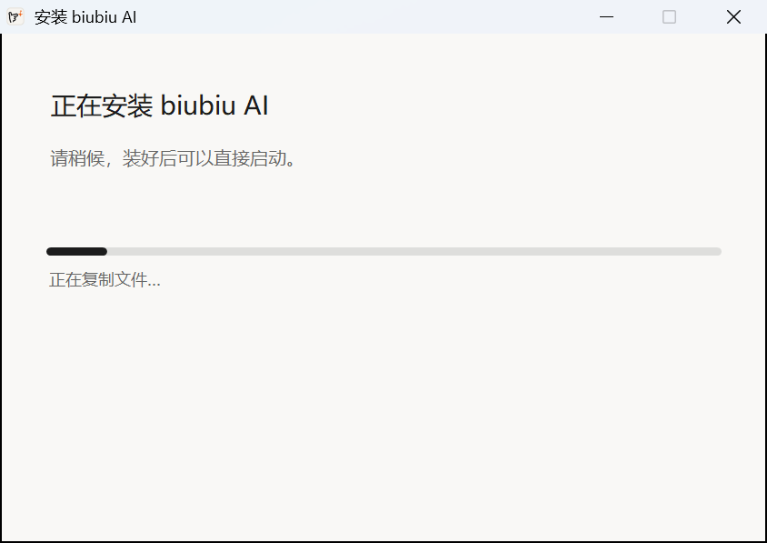

**第四步：完成。** 保持勾选 **现在启动 biubiu AI**，点 **完成**。

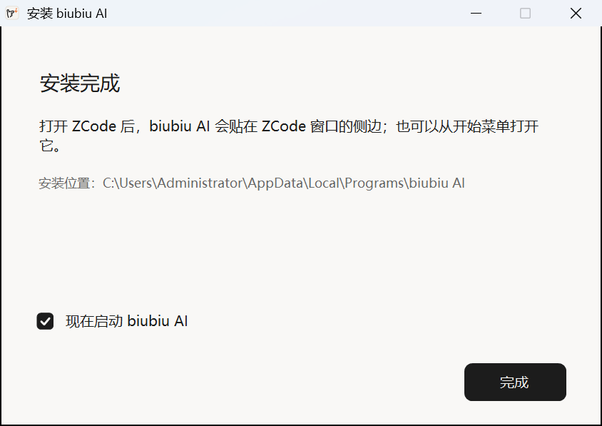

安装完成后，开始菜单（和桌面）上会有 **biubiu AI** 快捷方式，Windows「设置 → 应用」里也能看到它。

## 3. 第一次打开

打开 ZCode，biubiu AI 面板会贴在 ZCode 窗口的右边，跟着 ZCode 一起移动、缩放（见本页最上面的示意图）。

- ZCode **最大化** 时旁边没有空位，biubiu AI 收成贴在 ZCode 右边缘内侧的小标签 ，不会挡住 ZCode；点它就在 ZCode 里展开面板，用完点 **收起** 回到小标签。
- 打开 biubiu AI 时如果 ZCode 还没打开（或者最小化了），屏幕右下角会弹出通知「biubiu AI 已启动，图标在任务栏右下角。」，打开 ZCode 后面板就会出现。

面板顶部：

- **● 已连接**：表示 biubiu AI 的本地服务工作正常。
- **收起**：把面板收成贴在 ZCode 边上的小标签（见第 10 节）。
- 两个标签页：**biubiu AI**（账户页，默认打开）和 **连接服务**。

> 没看到面板？ZCode 最大化时找它右边缘内侧的小标签；ZCode 最小化时面板会自动隐藏，还原 ZCode 即可。也可以按 `Ctrl+Alt+M`，或者单击任务栏右下角的 biubiu AI 图标：面板出不来时会弹出通知说明原因。更多情况见 [常见问题](#13-常见问题)。

## 4. 登录 biubiu AI 账户

在 **biubiu AI** 标签页，填写在 ro.biubiu007.com 注册时用的 **邮箱** 和 **密码**，点 **登录**。

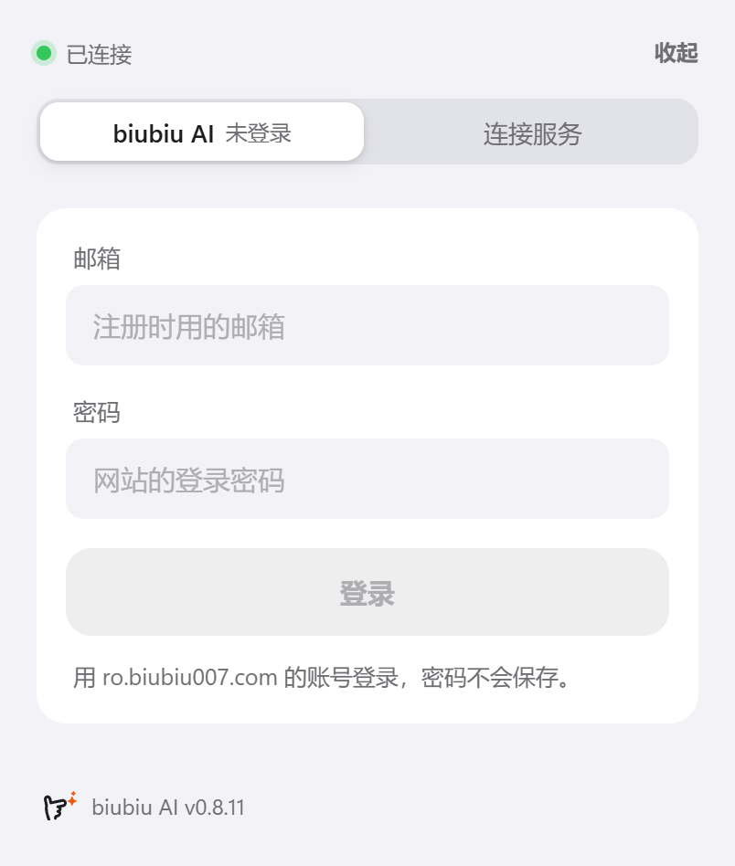

登录后，账户页从上到下是：

- **账户** 和 **累计充值**；
- **余额**（顶部标签上也会显示余额）；
- **打开 ro.biubiu007.com ↗**：在单独的窗口里打开网站，并且已经登录（见第 9 节）；
- **分组**：网站上你可以使用的分组（见第 5 节）；
- **站内 Key**：你账户里的 Key（见第 6 节）。

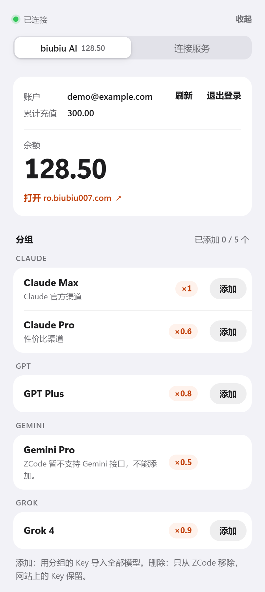

- 面板显示期间，余额每 30 秒自动刷新一次。
- 账户右边的 **刷新** 立即重新读取余额、分组和 Key；**退出登录** 会删除本机保存的登录状态。
- 密码只用来登录，不会保存。登录状态加密保存在本机，重启电脑后不用重新登录。

## 5. 一键添加分组

这是最常用的方式：**一个分组的全部模型，一次加进 ZCode**。

分组按平台（Claude、GPT……）列出，每行是分组名、说明和计费倍率（例如 `×0.6` 表示按 0.6 倍计费）。点分组右边的 **添加**：

- 分组里已经有可用的 Key 时，biubiu AI 用这个 Key 读取分组的全部模型，加进 ZCode，服务名是「**biubiu AI · 分组名**」。
- 分组里还没有 Key 时，会先在这一行里问你：

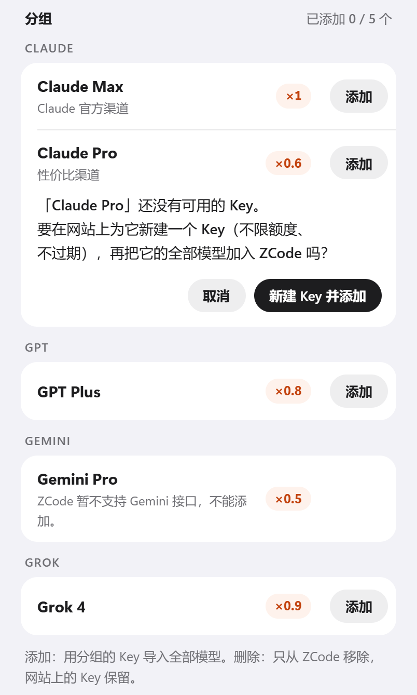

点 **新建 Key 并添加**，biubiu AI 会在网站上为这个分组新建一个 Key（名字是「ZCode · 分组名」，不限额度、不过期），再把模型加进 ZCode；不想新建就点 **取消**。

加好以后，这一行会注明「已加入 ZCode」和模型数，紧接着在这一行下面说明加了几个模型、加进了哪个服务（没加成时也在这里说明原因）：

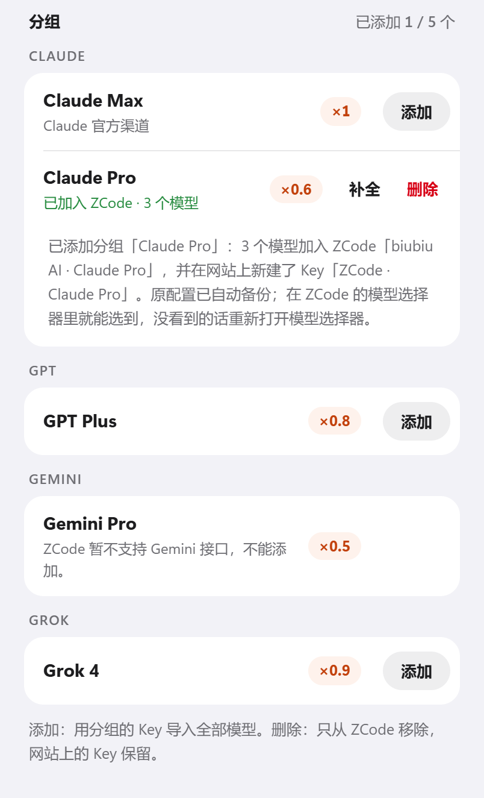

**回到 ZCode**，在模型选择里找到「biubiu AI · 分组名」，就能选用这些模型了；没看到的话，重新打开一次模型选择器。

- **补全**：已加入的分组行尾是 **补全** 和 **删除**。网站给分组加了新模型，或者你之前用下面的站内 Key 只加了其中几个，点 **补全** 就把还没加的模型加进同一个服务（不会多出一个服务）；都已经加过时会告诉你。
- **删除分组**：点已加入分组的 **删除**，再点 **确认删除**。这只会从 ZCode 里移除这个服务（删除前自动备份），网站上的 Key 保留。如果 ZCode 的默认模型正在使用它，会拒绝删除，请先在 ZCode 里换一个默认模型。
- **Gemini 分组** 只能查看：ZCode 暂不支持 Gemini 的原生接口。

## 6. 用站内 Key 选择模型

想只挑几个模型，或者用某个特定的 Key，就用站内 Key。账户页下方列出账户里的每个 Key：名称、状态、所属分组、Key（默认用圆点隐藏，点小眼睛才显示）、额度和到期时间。

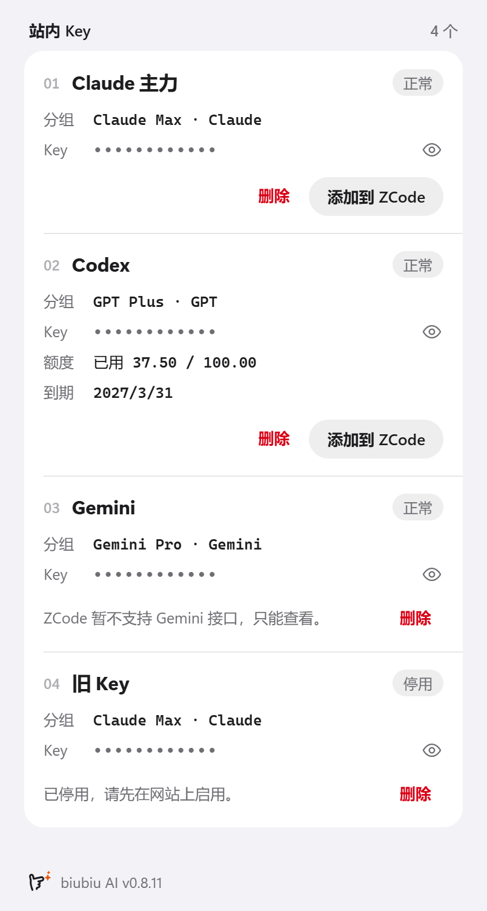

点 Key 的 **添加到 ZCode**，它的模型会在这个 Key 下方展开：

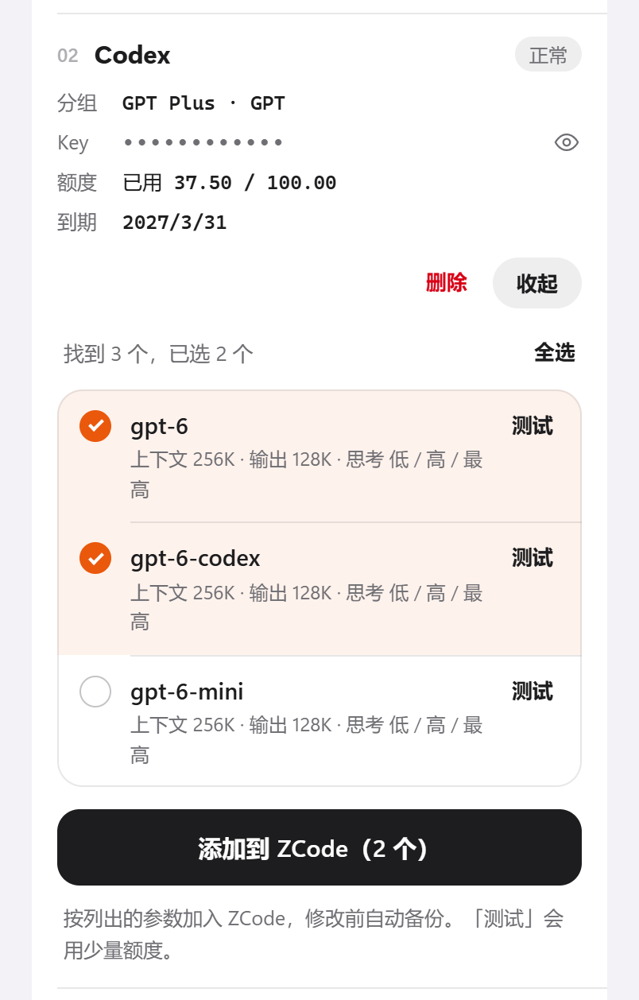

1. 勾选想要的模型（模型多于 8 个时可以搜索，也可以 **全选**）。每个模型下面写着加入后的参数：上下文、最大输出和思考档位。
2. 想先确认能不能用，点模型右边的 **测试**：只发一条很短的请求，会消耗极少的额度。
3. 点 **添加到 ZCode（N 个）**。

- 每个 Key 会成为 ZCode 里单独的服务（默认名「biubiu AI · Key 名称」），两个 Key 不会互相覆盖。
- 已经加进 ZCode 的 Key，按钮会变成 **选择模型**；再勾选的模型会合并进同一个服务，已在 ZCode 的模型保持勾选。
- 停用或过期的 Key 不能添加；Gemini 的 Key 只能查看。
- **删除站内 Key** 要谨慎：点 **删除** 再点 **确认删除**，会先删除 ZCode 里使用这个 Key 的所有服务（不另做备份），再在网站上删除这个 Key，删除后它就不能再用了。网站用来测试的 Key 不能删除。

## 7. 连接其他服务

如果你还有其他服务商（OpenAI 兼容或 Anthropic 接口）的地址和 Key，切到 **连接服务** 标签：

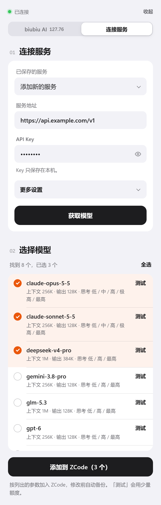

1. **已保存的服务**：新服务保持「添加新的服务」；选择 ZCode 里已有的服务时，Key 可以留空，沿用已保存的 Key。
2. **服务地址**：服务商提供的 API 地址，例如 `https://api.example.com/v1`。
3. **API Key**：粘贴服务商给你的 Key，点小眼睛可以查看输入的内容。
4. **更多设置**（可选）：
   - **接口协议**：大多数服务选「OpenAI 兼容（最常见）」；Claude 官方或兼容 Claude 的服务选「Anthropic（Claude）」；少数服务选「OpenAI Responses」。
   - **服务名称**：在 ZCode 里显示的名字，不填则使用网址的域名。
5. 点 **获取模型**，下方列出这个服务的全部模型。
6. 勾选要加的模型，点 **添加到 ZCode（N 个）**。

关于模型参数：biubiu AI 只给新加入的模型写三项：上下文窗口、最大输出和推理档位。ZCode 自己认识的模型沿用 ZCode 的值，其他模型统一按 256K 上下文、128K 最大输出、推理档位 低 / 高 / 最高 写入，服务商写明上限更小时会按实际情况往下调。其他设置请在 ZCode 的模型设置里修改。

## 8. 管理已导入的服务

**连接服务** 页下方常驻 **已导入的服务**，列出 ZCode 里每个自定义服务：

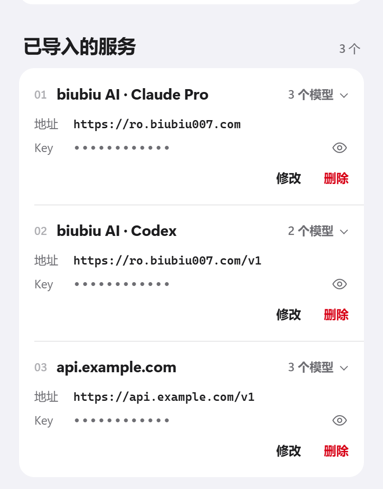

- **N 个模型**：点一下展开这个服务在 ZCode 里的模型名，再点收起。
- **地址** 和 **Key**：Key 默认用圆点隐藏，点小眼睛才显示完整 Key；面板收起或隐藏时会自动重新隐藏。
- **修改**：在原处修改服务地址和 API Key。Key 输入框留空表示不改 Key；ZCode 内置模板的服务（例如 DeepSeek）地址固定，只能改 Key。保存时只检查格式，不联网验证；想确认能用，在上方「已保存的服务」里选中它，再点获取模型。

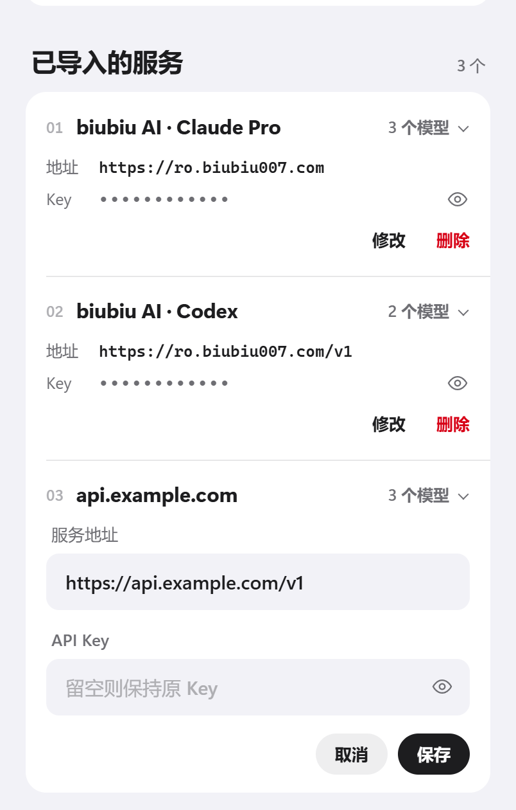

- **删除**：点 **删除** 再点 **确认删除**，这个服务连同它的模型和参数设置一起删除。ZCode 的默认模型仍来自这个服务时会拒绝删除，请先在 ZCode 里换一个默认模型。

每次修改和删除之前，biubiu AI 都会自动备份原来的配置（见 [常见问题](#13-常见问题) 里的“撤回一次修改”）。

## 9. 打开网站

账户页余额下方的 **打开 ro.biubiu007.com ↗** 会在一个单独的窗口里打开网站，并且已经登录面板里的这个账户，可以直接充值、查看用量等。再点一次会把已打开的窗口提到最前面；在面板里退出登录时，这个窗口会自动关闭。网站里指向其他网站的链接，会用你的默认浏览器打开。

## 10. 收起、贴边和快捷键

- **收起**：点面板右上角的 **收起**，或点面板朝向 ZCode 一侧的细条，面板就变成贴在 ZCode 边上的小标签 ；点小标签再展开。
- **快捷键 `Ctrl+Alt+M`**：面板收起时展开；已经展开时切换到面板；在面板里再按一次就收起。看不到面板时（比如 ZCode 最小化了）按它，会弹出通知说明原因，ZCode 回来时面板就在。
- **调整宽度**：拖动面板远离 ZCode 的那条边，宽度在 340 到 900 之间，松开后记住。
- **贴边规则**：默认贴在 ZCode 窗口右侧外面；右边屏幕放不下时改贴左侧；两边都放不下时，贴在 ZCode 窗口里面的边缘。托盘菜单里可以改成优先贴左侧。
- **ZCode 最大化时**：旁边没有空位，只在 ZCode 右边缘内侧显示小标签，不挡 ZCode；点小标签（或按快捷键）在 ZCode 里展开面板，收起后回到小标签。ZCode 还原后面板回到窗口外侧。
- **自动隐藏**：ZCode 最小化、关闭或窗口太小时，面板和小标签都会隐藏；ZCode 恢复后自动出现。
- **主题**：自动跟随 ZCode 的浅色或深色主题。

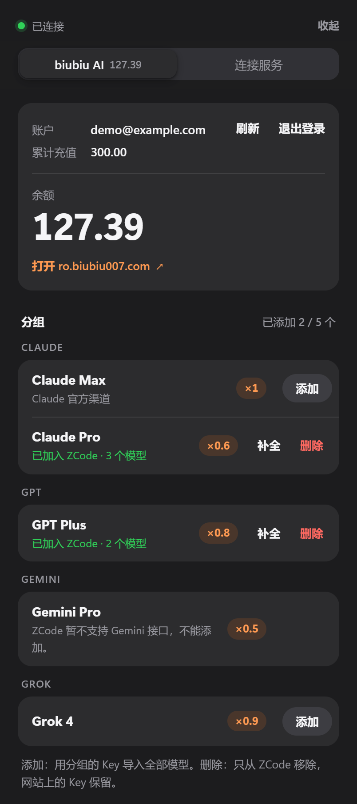

## 11. 托盘菜单和开机启动

biubiu AI 在任务栏右下角有一个小手枪图标（如果没看到，点任务栏右下角的 `^` 展开隐藏的图标）。单击图标展开或收起面板；右键打开菜单：

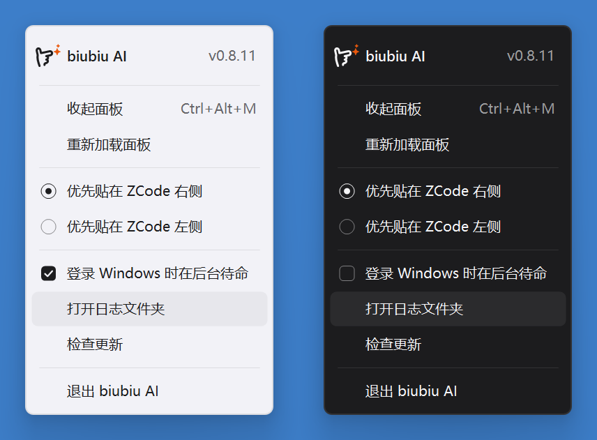

- **展开面板 / 收起面板**
- **重新加载面板**：面板显示不正常时用。
- **优先贴在 ZCode 右侧 / 左侧**
- **登录 Windows 时在后台待命**：勾选后，开机时 biubiu AI 在后台等待，打开 ZCode 就出现（和上次一样展开或收起）。
- **打开日志文件夹**：反馈问题时可以附上这里的 `companion.log`。日志里不会记录 Key、密码或令牌。
- **检查更新**：马上检查有没有新版本。发现新版本后，这一项会变成 **更新到 x.y.z…**（见第 12 节）。
- **退出 biubiu AI**

## 12. 更新和卸载

**更新**：biubiu AI 会自己检查新版本（每次启动约 2 分钟后检查一次，之后每 12 小时一次），有新版本时：

1. 屏幕右下角弹出一条通知「**biubiu AI 有新版本 x.y.z**」。同一个版本只提醒这一次，不会反复打扰。
2. 想更新时点这条通知。错过了也没关系，随时可以右键托盘图标选 **更新到 x.y.z…**，或者点面板最下方的 **新版本 x.y.z · 更新**：

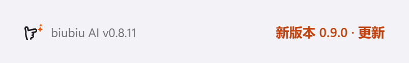

3. biubiu AI 先问你要不要更新。点 **是** 才开始；点 **否** 什么也不做，以后想更新再点上面任意一处：

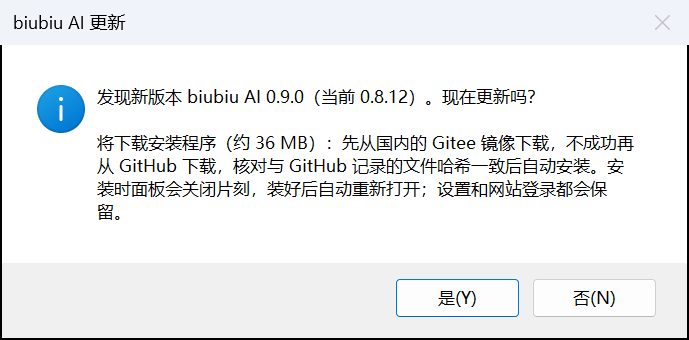

4. 它从本仓库的 GitHub Releases 下载新版本的安装程序，**核对文件哈希（SHA-256）和 GitHub 上记录的一致** 后自动安装：面板会关闭几秒钟，装好后自动重新打开，并提示「已更新到 x.y.z」。设置、网站登录、桌面快捷方式和开机后台待命都保持原样。如果下载的文件和 GitHub 的记录对不上，biubiu AI 会删掉它并提示，什么也不安装。

- 想马上检查，右键托盘图标选 **检查更新**。检查和下载会用系统的代理设置，和浏览器一样；GitHub 一时连不上时，过一会儿再试即可。
- 也可以像第一次安装那样，从 Releases 页面下载新版本的安装程序双击安装，它会装回原来的位置，设置和登录状态同样保留。
- 0.8.8 版还没有更新提醒：装的是 0.8.8 的话，请按第 1、2 节手动安装一次新版本，以后就能收到提醒了。

**卸载**：打开 Windows「设置 → 应用 → 安装的应用」，找到 **biubiu AI**，点 **卸载**（也可以运行安装文件夹里的 `Uninstall.exe`）：

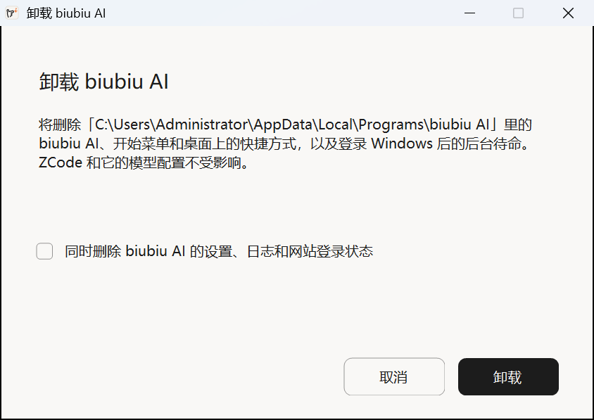

- 卸载会删除 biubiu AI 的程序文件、开始菜单和桌面快捷方式，以及开机后台待命。
- 勾选 **同时删除 biubiu AI 的设置、日志和网站登录状态**，可以删得更干净；不勾选的话，以后重新安装还能直接用原来的设置和登录。
- ZCode 和它的模型配置不受影响。之前加进 ZCode 的服务会保留，不想要的话，卸载前在面板里删除，或者在 ZCode 里删除。

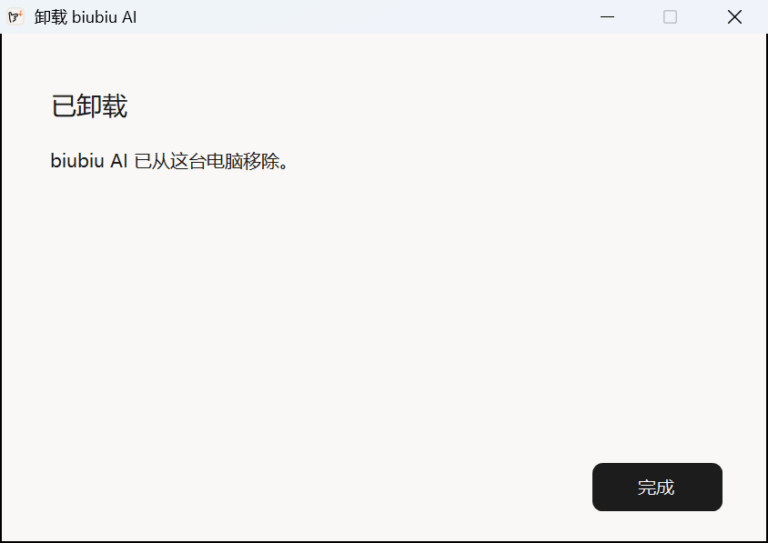

## 13. 常见问题

**打开 ZCode 后没有出现面板？**

1. ZCode 最大化时，面板收成 ZCode 右边缘内侧的小标签，点它展开；ZCode 最小化时面板会隐藏，还原 ZCode 即可。
2. 按 `Ctrl+Alt+M`，或者单击任务栏右下角的 biubiu AI 图标：面板出不来时会弹出通知说明原因。
3. 任务栏右下角没有 biubiu AI 图标，说明它没在运行：从开始菜单或桌面打开 **biubiu AI**，右下角会提示它已启动。
4. ZCode 窗口太小（小于 320×240）时面板也会隐藏，把 ZCode 窗口调大一些。

**面板里提示“本地服务连接失败”？** 右键托盘图标，点 **重新加载面板**；还不行的话点 **退出 biubiu AI**，再从开始菜单重新打开。

**提示“没有找到 Microsoft Edge WebView2 Runtime”？** 联网后重新运行一次安装程序，它会自动安装；也可以到 <https://go.microsoft.com/fwlink/p/?LinkId=2124703> 下载安装微软的 WebView2 运行时。

**安装时提示没有权限写入？** 换一个安装位置（例如默认位置），或者右键安装程序选择“以管理员身份运行”。

**模型加好了，在 ZCode 里找不到？** 在 ZCode 的模型选择里找服务「biubiu AI · 分组名」「biubiu AI · Key 名称」或你在连接服务时填写的服务名。

**想撤回一次修改？** biubiu AI 修改 ZCode 配置前，会把原配置备份到 `C:\Users\<你的用户名>\.zcode\v2\backups\model-harbor\`，只保留最近 10 份，更早的会自动删除。需要撤回时，先关闭 ZCode，再用对应时间的备份文件替换 `C:\Users\<你的用户名>\.zcode\v2\provider_config.json`。（删除站内 Key 时按设计不做备份，请在确认前想清楚。）

**biubiu AI 的数据存在哪里？**

- 程序：安装位置（默认 `%LOCALAPPDATA%\Programs\biubiu AI`）。
- 设置、日志、网站登录状态（加密）：`%LOCALAPPDATA%\ModelHarbor`。
- 加进 ZCode 的服务和 Key：ZCode 自己的配置文件里。

**杀毒软件报毒或拦截？** 安装程序还没有数字签名，部分杀毒软件会对新的、没有签名的程序比较敏感。请只从本仓库的 Releases 页面下载，可以按第 1 节核对 SHA-256，然后在杀毒软件里选择信任。

**会不会影响 ZCode？** 不会。biubiu AI 不修改 ZCode 的程序文件，也不注入 ZCode 进程，只读取 ZCode 窗口的位置和颜色来贴边和切换主题；它只通过 ZCode 的模型配置文件加入或删除你选择的服务，并且每次修改前都会备份。
